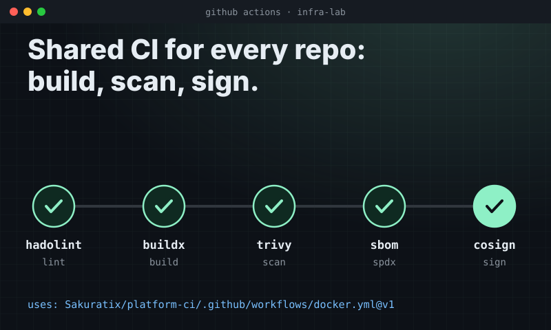
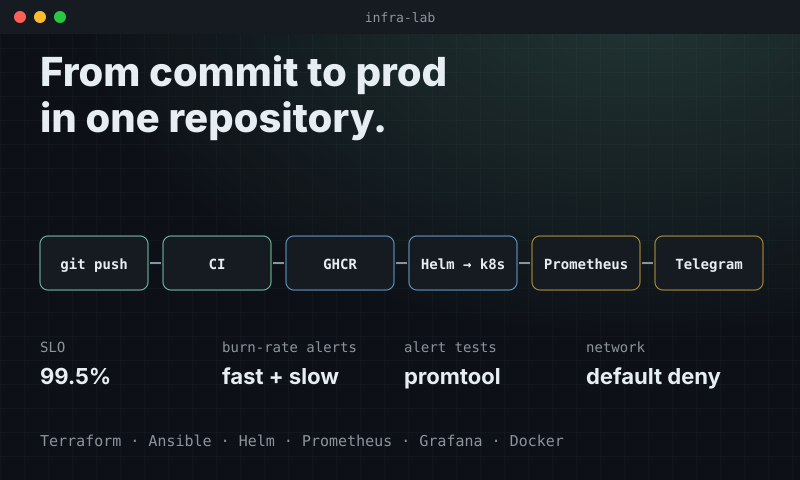
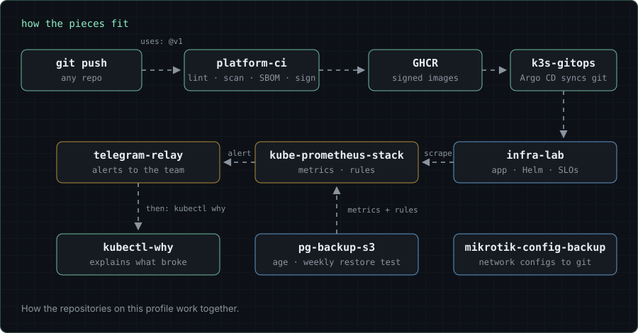
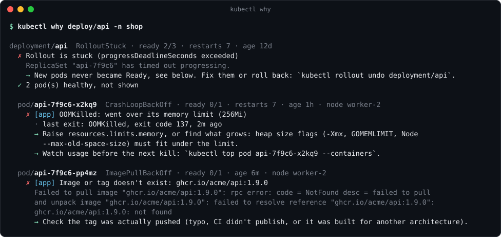
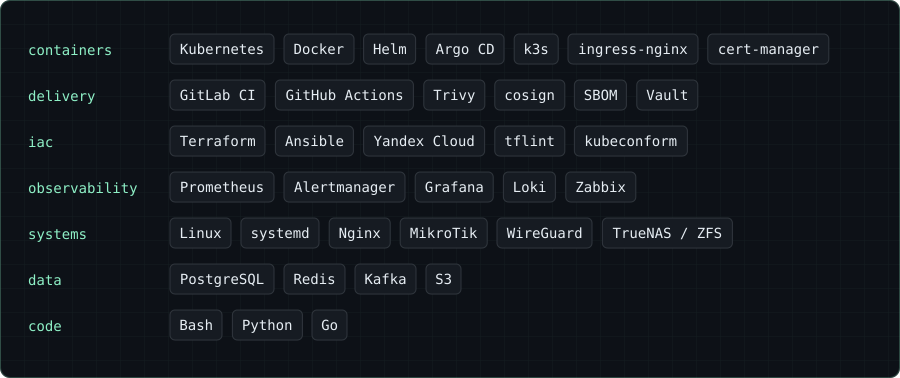

  

I'm Klim (sakuratox), a DevOps engineer. I build CI/CD, run Kubernetes, write infrastructure as code and set up monitoring, so releases are boring and alerts come before complaints.

  
  
  
  

CKA · Terraform Associate · MTCNA · English C1

<!-- stats:start -->

Joined GitHub this year · 16 contributions in the last 7 days

<!-- stats:end -->

## Built

<table>
<tr>
<td width="50%" valign="top">

 <a href="https://github.com/Sakuratix/kubectl-why"><b>kubectl-why</b></a> Go · kubectl plugin · 0 dependencies
 Explains in plain words why a pod or deployment is unhealthy, with the evidence and what to try next. Tested on a real kind cluster with pods broken on purpose.
</td>
<td width="50%" valign="top">

 <a href="https://github.com/Sakuratix/platform-ci"><b>platform-ci</b></a> GitHub Actions · Trivy · cosign
 Reusable workflows: image build, vulnerability scan, SBOM and keyless signing, plus Terraform and Helm checks, from one <code>uses:</code> line.
</td>
</tr>
<tr>
<td width="50%" valign="top">

 <a href="https://github.com/Sakuratix/infra-lab"><b>infra-lab</b></a> Terraform · Helm · Prometheus
 A service's whole path from commit to production in one repo: Terraform, Ansible, Helm chart, SLO burn-rate alerts with unit tests.
</td>
<td width="50%" valign="top">

 <a href="https://github.com/Sakuratix/k3s-gitops"><b>k3s-gitops</b></a> Argo CD · app of apps
 A k3s cluster where everything after the bootstrap comes from git, with AppProject guardrails and alerts when the cluster drifts.
</td>
</tr>
</table>

<b>More things I've made</b>

 

| | |
|---|---|
| [pg-backup-s3](https://github.com/Sakuratix/pg-backup-s3) | PostgreSQL backups to S3 with age encryption and a weekly automated restore check that reports the real RTO |
| [alertmanager-telegram-relay](https://github.com/Sakuratix/alertmanager-telegram-relay) | Alertmanager → Telegram without dependencies: splits big groups, retries rate limits, exposes its own metrics |
| [mikrotik-config-backup](https://github.com/Sakuratix/mikrotik-config-backup) | RouterOS configs to git in parallel, with a guard that refuses to commit secrets |
| [sakuratix.github.io](https://github.com/Sakuratix/sakuratix.github.io) | [My site](https://sakuratox.is-a.dev): one HTML file, three.js, and an easter egg if you click the cloud three times |

## How I work

| | principle | where you can see it |
|---|---|---|
| 🧪 | **Alerts are code, so they have tests.** An alert that never fired in a test will not fire at 3 a.m. either. | [infra-lab: promtool tests](https://github.com/Sakuratix/infra-lab/tree/main/monitoring/tests) |
| 📉 | **Page on the error budget, not on noise.** Burn-rate alerts instead of fixed thresholds. | [infra-lab: SLO rules](https://github.com/Sakuratix/infra-lab/blob/main/monitoring/alerts.yml) |
| 💾 | **A backup nobody restored is not a backup.** Restored automatically every week, RTO measured. | [pg-backup-s3: restore-check](https://github.com/Sakuratix/pg-backup-s3/blob/main/restore-check.sh) |
| 🔁 | **Nothing is changed by hand.** The cluster is whatever git says; drift raises an alert. | [k3s-gitops](https://github.com/Sakuratix/k3s-gitops) |
| 🔏 | **The supply chain is part of CI.** Every image scanned, described by an SBOM and signed. | [platform-ci](https://github.com/Sakuratix/platform-ci) |
| 🔐 | **Secrets never reach git.** Guards refuse to commit them; backups are encrypted off-host. | [mikrotik-config-backup](https://github.com/Sakuratix/mikrotik-config-backup) |
| 🩺 | **Tools should explain, not dump.** Make the 3 a.m. diagnosis someone else's 30 seconds. | [kubectl-why](https://github.com/Sakuratix/kubectl-why) |

## The platform

## Break my cluster

Pick a failure. It opens an issue; press **Create** and within a minute a bot replays that failure on a recorded cluster, runs the real [kubectl-why](https://github.com/Sakuratix/kubectl-why) on it and answers you in the issue.

<!-- break-menu:start -->

<!-- break-menu:end -->

<!-- break-log:start -->
**Broken 0 times so far.**
<!-- break-log:end -->

## Incident of the day

<!-- incident:start -->
**Incident of the day, 18 November 2026:** Stuck in Terminating for 38m

Every day this section picks one of the failures that [kubectl-why](https://github.com/Sakuratix/kubectl-why) recognises, replays the recorded cluster state with today's clock and lets the tool explain it. Today's fix: A controller is supposed to remove these finalizers. Check that it is running before removing them by hand.

<!-- incident:end -->

  <picture>
    <source media="(prefers-color-scheme: dark)" srcset="assets/snake-dark.svg">
    
  </picture>
   the contribution graph, eaten daily by <a href=".github/workflows/snake.yml">a snake</a>

## Stack

---

<b>Open to remote DevOps roles.</b> Fastest way to reach me:

  
  

Updated daily by <a href=".github/workflows/update.yml">a GitHub Action</a> · <a href="https://sakuratox.is-a.dev">sakuratox.is-a.dev</a> · numbers and the incident are refreshed by the Action, not typed by hand

